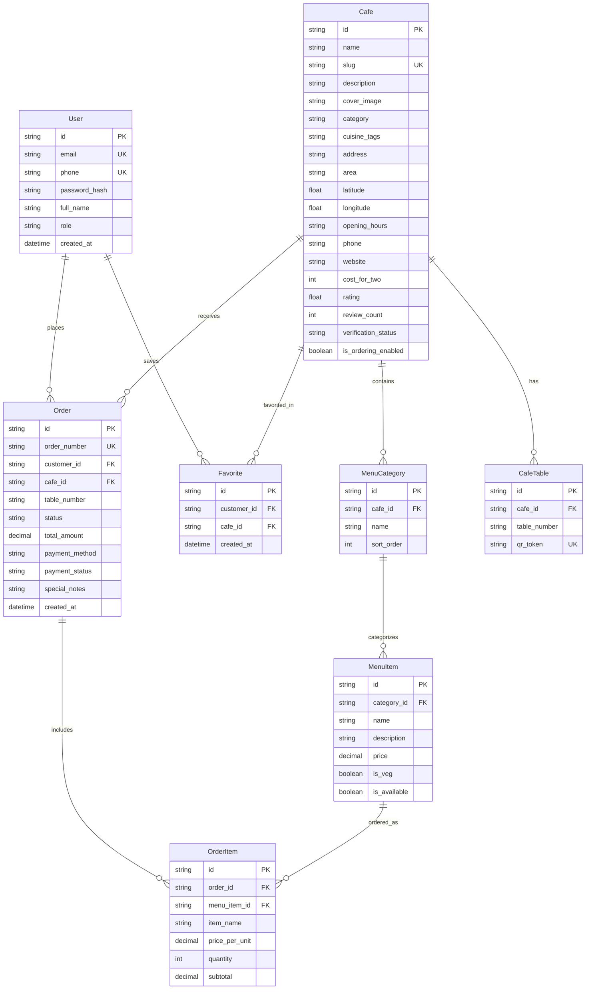

# ZipBi Database Schema Documentation

## 1. Overview
The database uses PostgreSQL (compatible with Supabase) and is managed via Prisma ORM. The relational model enforces referential integrity, indexes query hotspots, and provides multi-tenant separation for future merchant and admin modules.

---

## 2. Entity Relationship Diagram (ERD)



---

## 3. Prisma Schema Definition (`prisma/schema.prisma`)

```prisma
datasource db {
  provider = "postgresql"
  url      = env("DATABASE_URL")
}

generator client {
  provider = "prisma-client-js"
}

enum Role {
  CUSTOMER
  MERCHANT
  ADMIN
}

enum VerificationStatus {
  UNCLAIMED
  VERIFICATION_PENDING
  VERIFIED
  ACTIVE_PARTNER
  SUSPENDED
}

enum OrderStatus {
  PENDING
  ACCEPTED
  PREPARING
  READY
  COMPLETED
  CANCELLED
}

enum PaymentMethod {
  CASH_OR_UPI_AT_COUNTER
  ONLINE
}

enum PaymentStatus {
  PENDING
  PAID
  REFUNDED
}

model User {
  id            String      @id @default(uuid())
  email         String?     @unique
  phone         String      @unique
  passwordHash  String      @map("password_hash")
  fullName      String      @map("full_name")
  role          Role        @default(CUSTOMER)
  createdAt     DateTime    @default(now()) @map("created_at")
  updatedAt     DateTime    @updatedAt @map("updated_at")

  orders        Order[]
  favorites     Favorite[]

  @@map("users")
}

model Cafe {
  id                  String             @id @default(uuid())
  name                String
  slug                String             @unique
  description         String?
  coverImage          String?            @map("cover_image")
  category            String             @default("Café")
  cuisineTags         String[]           @map("cuisine_tags")
  address             String
  area                String
  latitude            Float
  longitude           Float
  distancePsgCasKm    Float?             @map("distance_psg_cas_km")
  openingHours        String?            @map("opening_hours")
  phone               String?
  website             String?
  costForTwo          Int?               @map("cost_for_two")
  costForTwoSource    String?            @map("cost_for_two_source")
  rating              Float?
  reviewCount         Int?               @map("review_count")
  verificationStatus  VerificationStatus @default(UNCLAIMED) @map("verification_status")
  isOrderingEnabled   Boolean            @default(false) @map("is_ordering_enabled")
  hasPublishedMenu    Boolean            @default(false) @map("has_published_menu")
  createdAt           DateTime           @default(now()) @map("created_at")
  updatedAt           DateTime           @updatedAt @map("updated_at")

  categories          MenuCategory[]
  tables              CafeTable[]
  orders              Order[]
  favorites           Favorite[]

  @@index([latitude, longitude])
  @@index([verificationStatus])
  @@map("cafes")
}

model MenuCategory {
  id        String     @id @default(uuid())
  cafeId    String     @map("cafe_id")
  name      String
  sortOrder Int        @default(0) @map("sort_order")
  createdAt DateTime   @default(now()) @map("created_at")

  cafe      Cafe       @relation(fields: [cafeId], references: [id], onDelete: Cascade)
  items     MenuItem[]

  @@map("menu_categories")
}

model MenuItem {
  id          String       @id @default(uuid())
  categoryId  String       @map("category_id")
  name        String
  description String?
  price       Decimal      @db.Decimal(10, 2)
  isVeg       Boolean      @default(true) @map("is_veg")
  isAvailable Boolean      @default(true) @map("is_available")
  createdAt   DateTime     @default(now()) @map("created_at")

  category    MenuCategory @relation(fields: [categoryId], references: [id], onDelete: Cascade)
  orderItems  OrderItem[]

  @@map("menu_items")
}

model CafeTable {
  id          String   @id @default(uuid())
  cafeId      String   @map("cafe_id")
  tableNumber String   @map("table_number")
  qrToken     String?  @unique @map("qr_token")
  createdAt   DateTime @default(now()) @map("created_at")

  cafe        Cafe     @relation(fields: [cafeId], references: [id], onDelete: Cascade)

  @@unique([cafeId, tableNumber])
  @@map("cafe_tables")
}

model Order {
  id            String        @id @default(uuid())
  orderNumber   String        @unique @map("order_number")
  customerId    String        @map("customer_id")
  cafeId        String        @map("cafe_id")
  tableNumber   String        @map("table_number")
  status        OrderStatus   @default(PENDING)
  totalAmount   Decimal       @map("total_amount") @db.Decimal(10, 2)
  paymentMethod PaymentMethod @default(CASH_OR_UPI_AT_COUNTER) @map("payment_method")
  paymentStatus PaymentStatus @default(PENDING) @map("payment_status")
  specialNotes  String?       @map("special_notes")
  createdAt     DateTime      @default(now()) @map("created_at")
  updatedAt     DateTime      @updatedAt @map("updated_at")

  customer      User          @relation(fields: [customerId], references: [id])
  cafe          Cafe          @relation(fields: [cafeId], references: [id])
  items         OrderItem[]

  @@index([customerId])
  @@index([cafeId])
  @@index([status])
  @@map("orders")
}

model OrderItem {
  id           String   @id @default(uuid())
  orderId      String   @map("order_id")
  menuItemId   String   @map("menu_item_id")
  itemName     String   @map("item_name")
  pricePerUnit Decimal  @map("price_per_unit") @db.Decimal(10, 2)
  quantity     Int
  subtotal     Decimal  @db.Decimal(10, 2)

  order        Order    @relation(fields: [orderId], references: [id], onDelete: Cascade)
  menuItem     MenuItem @relation(fields: [menuItemId], references: [id])

  @@map("order_items")
}

model Favorite {
  id         String   @id @default(uuid())
  customerId String   @map("customer_id")
  cafeId     String   @map("cafe_id")
  createdAt  DateTime @default(now()) @map("created_at")

  customer   User     @relation(fields: [customerId], references: [id], onDelete: Cascade)
  cafe       Cafe     @relation(fields: [cafeId], references: [id], onDelete: Cascade)

  @@unique([customerId, cafeId])
  @@map("favorites")
}
```

